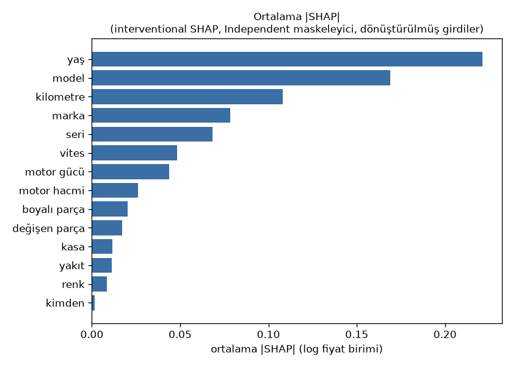

# Kilometrix — İkinci El Araç Fiyat Tahmini (Türkiye)

arabam.com'daki Haziran 2025 ilanlarıyla eğitilmiş, klasik makine öğrenmesi tabanlı bir ikinci el
otomobil **ilan fiyatı** tahmin modeli. Streamlit arayüzünde araç bilgileri girilir; uygulama tahmini
fiyatı, tipik hata aralığını ve SHAP ile her özelliğin tahmine etkisini gösterir.

## Sonuçlar
Nihai model: `HistGradientBoostingRegressor` (log fiyat üzerinde, 31 yaprak, 1 500 ağaç).
Model, 17 aday (Ridge, HistGradientBoosting, XGBoost) arasından **yalnızca eğitim verisindeki 5 katlı
grup bazlı çapraz doğrulamayla** seçildi (doğrulama MAPE %10,56). Test seti seçimden sonra açıldı.

| Test seti (10 068 ilan) | MAPE | Medyan APE | MAE (TL) |
|---|---|---|---|
| Genel medyan (baseline) | %73,9 | %48,8 | 529 198 |
| Marka+seri+model medyanı (baseline) | %16,8 | %11,6 | 156 755 |
| **HistGradientBoosting** | **%10,4** | **%6,7** | **98 096** |

- MAPE: ortalama mutlak yüzde hata; Medyan APE: ilanların yarısında hata bu oranın altında.
- Hata ucuz araçlarda daha yüksek: en ucuz çeyrekte MAPE %17,1, diğer çeyreklerde %7-10.
- Eğitimde hiç görülmemiş marka+seri+model kombinasyonlarında (294 test ilanı) MAPE %22,4.
- Eğitim MAPE'si tam-train hedef kodlarıyla %7,70; modelin eğitim sırasında gördüğü çapraz kodlarla %7,45'tir.
  Test MAPE'si %10,4 olduğundan yaklaşık 3 puanlık eğitim–test (genelleme) farkı vardır
  ([reports/adim4_te_train_kontrol.txt](reports/adim4_te_train_kontrol.txt)).
- **Bu sonuçlar iyimser olabilir.** Veride ilan numarası olmadığı için aynı aracın yeniden
  yayımlanmış ilanları tam ayıklanamadı (aşağıda "Yöntem").

Ayrıntılı raporlar: [reports/](reports/) (`adim3_baseline.txt`, `adim4_karsilastirma.txt`,
`adim4_test.txt`, `adim5_shap.txt`).

### Model neye bakıyor? (SHAP)


Tahmini en çok aracın yaşı, araç modeli (marka/seri/model) ve kilometre belirliyor. Yaş ve km arttıkça
tahmin düşüyor; motor gücü ve otomatik vites tahmini artırıyor. Satıcı türünün (`kimden`) etkisi
neredeyse yok.

Okurken: SHAP modelin **nasıl davrandığını** açıklar, neden-sonuç ilişkisi değildir. Değerler ön
işlemeden sonraki girdiler üzerinde, bağımsız maskeleme ile hesaplandı (interventional SHAP;
`PermutationExplainer`, eğitimden 200 satır arka plan). Birbirine bağlı özellikler (marka/seri/model,
yaş/km) etkiyi aralarında keyfi bölüşebilir. Diğer grafikler: [reports/figures/](reports/figures/).

## Uygulamayı çalıştırma
Gerekli Python sürümü: **3.13** (paket sürümleri bu sürümle sabitlendi).

```bash
python -m venv .venv
# Windows
.venv\Scripts\activate
# macOS / Linux
source .venv/bin/activate

pip install -r requirements.txt
streamlit run app/streamlit_app.py
```

Uygulama yalnızca `models/` altındaki dosyaları okur; veri dosyası gerekmez, model yeniden eğitilmez.
Açılışta model, SHAP arka planı ve form seçeneklerinin birbirine uyduğu (sha256, scikit-learn sürümü)
denetlenir; uymazsa uygulama hata verir.

**Streamlit Community Cloud:** ana dosya `app/streamlit_app.py`, gelişmiş ayarlarda Python **3.13**
seçilmelidir. Paketler kökteki `requirements.txt`'den kurulur.

## Veri
> Veri: Mehmet Tanrıverdi, "Used Car Prices Dataset (Turkey - arabam.com)", Kaggle, 2025.
> https://www.kaggle.com/datasets/mehmettanriverdi/used-car-prices-dataset-turkey-arabam-com
> Kaggle lisans alanı: CC0 1.0; sayfa alt başlığı: "Non-commercial use". Kaynak site: arabam.com,
> Haziran 2025 ilanları. Bu proje ticari değildir.

- **Lisans çelişkili:** lisans alanı CC0 (ticari kullanıma izin verir), sayfa alt başlığı "Non-commercial
  use" diyor. Hangisinin geçerli olduğu doğrulanamadı; ticari kullanım düşünülürse yazara sorulmalı.
- Ham veri bu repoda **yeniden dağıtılmaz** (`data/raw/` git dışı). Ayrıntılar ve kullanılmayan ikinci
  veri setinin neden elendiği: [docs/DATA.md](docs/DATA.md).

### Sınırlar
- **İlan fiyatıdır**, gerçekleşen satış fiyatı değildir.
- **Tek dönem (Haziran 2025):** tahminler o tarihin TL düzeyindedir; enflasyona göre güncellenmez.
- **Kapsam binek otomobil:** SUV, arazi ve pick-up ilanları çok az; bu araçlarda tahmin güvenilir değildir.
- Marka dağılımı örnekleme kotası izlenimi veriyor (büyük markalarda ~2 500 ilan tavanı); piyasa
  paylarını temsil ettiği varsayılamaz.
- Bu bir tahmindir; ekspertiz ve piyasa araştırmasının yerini tutmaz.

## Yöntem (kısaca)
1. **Temizleme** (`cleaning.py`): 50 755 → 50 459 satır (158 tamamen boş, 138 olası kopya). Aykırı
   değerler değerlendirme kümelerinden atılmadı. Boş "değişen/boyalı parça" sayıları 0 değil
   "bilinmiyor" sayıldı.
2. **Bölme** (`split.py`): veride tarih ve ilan no yok. Aynı aracın tekrar ilanları hem eğitimde hem
   testte olmasın diye marka+seri+model+yıl+km grubuyla **grup bazlı** bölme (test ≈ %20) ve grup bazlı
   5 katlı çapraz doğrulama. Bu anahtar yaklaşıktır: km'si güncellenmiş aynı araç başka gruba düşebilir;
   sızıntı azaltılır ama garanti engellenmez.
3. **Özellikler** (`features.py`): yaş, log(km), marka / seri / model kategorileri; tüm ön işleme
   scikit-learn `Pipeline` içinde, yalnızca eğitim kısmına uydurulur. Seri ve model hedef kodlamayla
   (`TargetEncoder`, çapraz uydurma) sayıya çevrilir.
4. **Model seçimi** (`compare.py`, `final.py`): seçim kuralı sonuçlardan önce yazıldı; ölçüt çapraz
   doğrulama MAPE'si. Seçilen model tüm eğitim verisiyle eğitildi, test bir kez değerlendirildi.
5. **Açıklama** (`explain.py`) ve **arayüz** (`predict.py`, `app/streamlit_app.py`).

Adım adım kararlar ve denetim notları: [docs/PROGRESS.md](docs/PROGRESS.md).

## Sonuçları yeniden üretme
Kaggle'dan `car_price_prediction.csv` dosyasını indirip `data/raw/` altına koyun, geliştirme paketlerini
kurun (`pip install -r requirements-dev.txt`: uygulama paketleri + xgboost + jupyter) ve proje kökünden
sırayla çalıştırın:

```bash
# Windows PowerShell: $env:PYTHONPATH = "src"
export PYTHONPATH=src

python -m arac_fiyat.cleaning   # temiz veri  -> data/processed/
python -m arac_fiyat.train      # baseline'lar ve Ridge, CV -> reports/adim3_baseline.txt
python -m arac_fiyat.compare    # 17 aday, CV -> reports/adim4_karsilastirma.txt
python -m arac_fiyat.final      # nihai model + tek test değerlendirmesi -> models/
python -m arac_fiyat.explain    # SHAP (~12 dk) -> reports/adim5_shap.txt, reports/figures/
python -m arac_fiyat.predict    # form seçenekleri -> models/form_options.json
```

`final.py`, test raporu (`reports/adim4_test.txt`) zaten varsa çalışmaz (test bir kez açılsın diye);
yeniden üretmek için o dosyayı bilerek silmek gerekir.

## Klasör yapısı
```
app/             Streamlit arayüzü
src/arac_fiyat/  temizleme, bölme, özellik, eğitim, değerlendirme, açıklama, tahmin kodu
models/          eğitilmiş model, SHAP arka planı, form seçenekleri
reports/         adım raporları (.txt) ve grafikler (figures/)
docs/            veri belgesi (DATA.md) ve ilerleme günlüğü (PROGRESS.md)
data/            raw ve processed git dışı
```
